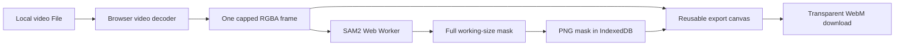

# Isolate

Isolate is a private, browser-native rotoscoping application for extracting a subject from short video clips. A user opens a local video, marks the subject with positive and negative points, propagates the selection across frames with SAM2, corrects individual masks, and downloads one transparent WebM cutout.

The application is entirely client-side. Vercel serves static files, but video decoding, model inference, mask storage, compositing, and export run on the user's own GPU or CPU. Source footage is never uploaded to an application server.

## How the rotoscoping pipeline works

1. **Admit the clip.** The browser reads video metadata and rejects clips longer than 20 seconds or larger than 500 MB.
2. **Choose a working resolution.** Source resolution is preserved up to a 2K/QHD envelope. Larger sources are reduced proportionally before frame extraction.
3. **Decode one frame.** `VideoFrameReader` seeks the browser's native video element and copies only the requested frame into a reusable canvas.
4. **Prompt the subject.** Positive points identify the subject; negative points exclude unwanted regions.
5. **Run SAM2 locally.** The active frame is transferred to a Web Worker. Transformers.js preprocesses it to SAM2's fixed 1024×1024 neural input and runs the quantized ONNX model.
6. **Restore mask resolution.** SAM2's result is post-processed to the current working-frame dimensions. This preserves a 2K output canvas without claiming native 2K neural detail.
7. **Propagate sequentially.** Points sampled from the previous mask guide the next frame. Forward, backward, and bidirectional passes are cancellable between frames.
8. **Persist completed masks.** Each alpha mask is compressed to PNG and written to IndexedDB before processing continues.
9. **Export the cutout.** Each source-timed video frame is combined with its nearest stored alpha mask on reused canvases and recorded as a silent transparent VP9 or VP8 WebM. This preserves the uploaded clip's presentation cadence without storing more SAM2 masks.



## Local hardware execution

Isolate selects the best compute path available in the browser:

- **WebGPU:** preferred when `navigator.gpu` and a compatible adapter are available. The SAM2.1 tiny model uses `q4f16` weights to reduce device-memory pressure.
- **CPU/WASM:** automatic fallback when WebGPU is unavailable or initialization fails. It uses `q8` weights and up to four WebAssembly threads, bounded by the device's reported hardware concurrency.
- **No hosted inference:** there is no server GPU, API upload, or cloud-render fallback. Performance depends on the user's browser, GPU, CPU, available memory, and thermal limits.

The first mask operation downloads `onnx-community/sam2.1-hiera-tiny-ONNX` from Hugging Face. Browser caching normally prevents downloading the model again, although clearing site data removes that cache.

## Memory and buffer strategy

Video work can consume memory rapidly, especially at 2K. Isolate avoids decoding or retaining a complete frame sequence.

### Active-frame memory

Only the requested RGBA frame is decoded. An RGBA frame needs four bytes per pixel before browser and inference-runtime overhead:

| Working size | Approximate RGBA buffer | One-byte alpha mask |
| --- | ---: | ---: |
| 1280×720 | 3.5 MiB | 0.9 MiB |
| 1920×1080 | 7.9 MiB | 2.0 MiB |
| 2560×1440 | 14.1 MiB | 3.5 MiB |

Temporary preprocessing, RGB conversion, ONNX tensors, model weights, GPU resources, canvas backing stores, and browser internals require additional memory. These values therefore describe individual application buffers, not total tab or GPU memory.

### Inference lifecycle

- A copied frame buffer is transferred to the worker so inference does not block the interface.
- Only the current frame's SAM2 image embedding is cached.
- Moving to another frame disposes the previous embedding before caching the next one.
- Tracking processes frames sequentially and commits each PNG mask before advancing.
- Analysis runs at 6–8 FPS and is capped at 200 frames, keeping the workload bounded for a 20-second clip.

### Storage and export bounds

- PNG masks have a **64 MB per-project IndexedDB ceiling**.
- The original video is referenced through a revocable object URL and is not copied into IndexedDB.
- Project metadata and frame states are stored separately from the source video.
- Export reuses output and alpha canvases rather than accumulating decoded source frames.
- MediaRecorder chunks are retained only until the WebM is finalized, with a **64 MB compressed-output ceiling**.
- The model's browser cache is managed by the browser and is separate from the mask-cache limit.

## Runtime limits

| Constraint | Behavior |
| --- | --- |
| Duration | Maximum 20 seconds |
| Source file | Maximum 500 MB |
| Landscape resolution | Preserved through 2560×1440 |
| Portrait resolution | Preserved through 1440×2560 |
| Other aspect ratios | Maximum 2560-pixel edge and 3.69 megapixels |
| Analysis | 6–8 FPS, no more than 200 frames |
| Mask cache | 64 MB per local project |
| Video export | 4–12 Mbps, maximum 64 MB |
| Output | Silent transparent WebM at the browser-presented source cadence |

## Browser and media support

Chrome or Edge with WebGPU provides the best experience. Firefox can use the WASM path and supports WebM export where MediaRecorder exposes VP9 or VP8. Safari is not supported for transparent export because its WebM pipeline discards alpha.

Input support follows the browser's installed decoders rather than a bundled FFmpeg build. H.264 video in MP4 and VP9 video in WebM are the recommended inputs. A file can pass its extension check and still fail if the browser cannot decode its specific codec, profile, bit depth, or container combination.

## Installation

Requirements:

- Node.js 20 or newer
- npm
- A current desktop browser

```bash
git clone https://github.com/Ioncrade/Isolate.git
cd Isolate
npm install
npm run dev
```

Open `http://localhost:5173` for the landing page. The editor is available at `http://localhost:5173/studio`.

No Python environment, model checkpoint installation, database server, API key, or application secret is required. The model downloads through the browser on first use.

## Development commands

```bash
npm run dev       # Start the Vite development server
npm run lint      # Run the TypeScript project checks
npm test          # Run the Vitest test suite once
npm run build     # Create the production bundle in dist/
npm run preview   # Serve the production bundle locally
```

Run the complete verification sequence before deployment:

```bash
npm run lint
npm test
npm run build
```

## Editor controls

- Click to add the selected Subject or Exclude prompt.
- Right-click to add an Exclude prompt.
- Scroll over the video to zoom from 1× to 8× around the pointer.
- While zoomed, hold `Space` and drag to pan.
- Use arrow keys to move the keyboard annotation cursor and `Enter` to place a prompt.
- Use `[` and `]` to move between frames and `A` or `X` to change prompt mode.

## Project structure

```text
web/
├── src/
│   ├── App.tsx                 # Rotoscoping studio and workflow state
│   ├── LandingPage.tsx         # Public product introduction
│   ├── components/             # Canvas and interaction components
│   ├── lib/                    # Limits, storage, video, tracking, and export
│   └── workers/sam2.worker.ts  # Local SAM2 initialization and prediction
├── public/                     # Self-hosted fonts
├── scripts/                    # Visual capture tooling
├── ARCHITECTURE.md             # Browser-service mapping and invariants
├── vercel.json                 # Static deployment and isolation headers
└── vite.config.ts              # Vite and worker configuration
```

## Session recovery and privacy

IndexedDB stores project metadata and compressed masks. `sessionStorage` mirrors the active project and frame. The source video is intentionally not persisted, so after a reload the user must choose the same local file to reconnect saved masks.

The application contacts Hugging Face to obtain model files on first use. Apart from that model download and normal static-site delivery, the rotoscoping workflow does not transmit source frames, masks, prompts, or exported video.

## Deploying to Vercel

Use this repository as the Vercel project root. The included configuration:

- runs `npm run build`;
- publishes `dist/`;
- rewrites `/studio` to the single-page application;
- enables `Cross-Origin-Opener-Policy` and `Cross-Origin-Embedder-Policy` for threaded WebAssembly;
- adds immutable caching headers to fingerprinted assets.

No Vercel Functions, server GPU, database, environment variables, or persistent volume are needed.

## Troubleshooting

- **Model loading is slow:** the first run must download and compile the model. Keep the tab open and allow the browser cache to finish.
- **WebGPU is unavailable:** update the browser and graphics driver. Isolate will otherwise use CPU/WASM, which is slower.
- **The video will not open:** transcode it to H.264/MP4 or VP9/WebM and confirm it is within the duration and size limits.
- **Mask storage is full:** export the current result or clear the local project before processing another large clip.
- **Transparent output appears black:** verify the file in software that supports WebM alpha. Some players composite transparency over black.
- **Safari export fails:** use Chrome, Edge, or Firefox for transparent WebM output.
- **A reload cannot restore the video:** this is expected; select the same source file to reconnect the locally cached masks.

## Known trade-offs

- SAM2's neural input remains 1024×1024 even when masks and output use a larger working resolution.
- The browser implementation samples 6–8 analysis frames per second rather than preserving the original source frame rate.
- Output has no audio.
- Bidirectional propagation uses points sampled from prior masks; it is not the full stateful native SAM2 video predictor.
- Device-specific browser and GPU limits can still terminate a tab before application-level ceilings are reached.
